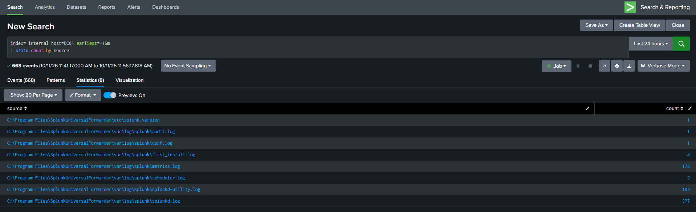
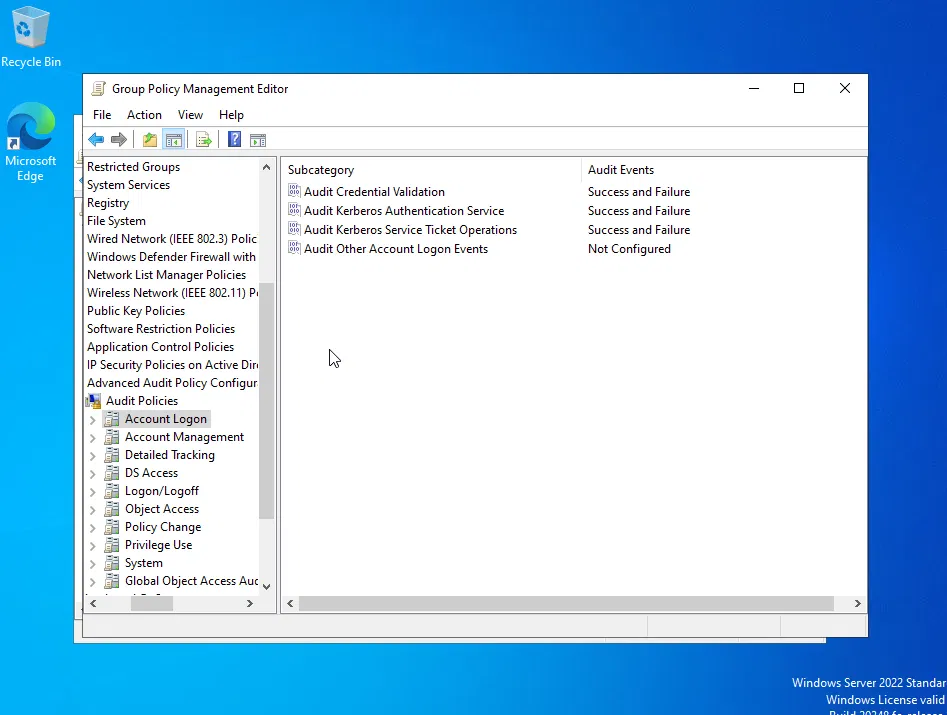
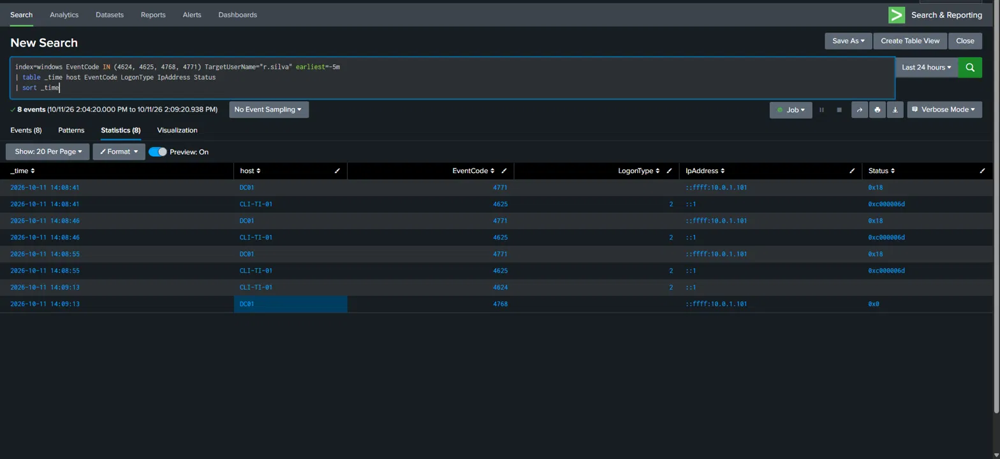

# 05 — Camada de identidade: forwarder no DC e o ponto cego da auditoria

## Objetivo

Trazer a **camada de identidade** para o SIEM: enviar os logs do controlador de domínio (DC01) ao Splunk e garantir que as **tentativas de logon que falham** fiquem registradas, para correlacioná-las com os eventos do endpoint.

## Cenário

Até aqui, só o WIN10 (CLI-TI-01) e o pfSense enviavam logs ao Splunk. O DC01, que autentica todo o domínio `meulab.local`, era invisível para o SIEM.

| Ativo | IP | Papel |
|---|---|---|
| DC01 | 10.0.2.10 | Active Directory, DNS, Kerberos |
| Splunk | 10.0.2.20 | SIEM (recebe na porta 9997) |
| CLI-TI-01 | 10.0.1.101 | Endpoint onde os logons são feitos |

DC01 e Splunk estão no **mesmo segmento** (SERVERS), então o envio na 9997 não passa pelo pfSense e não exige regra nova.

## Por que isso importa em um SOC

- O DC registra **toda** autenticação do domínio, inclusive a de máquinas que não têm agente de coleta.
- Uma senha errada deixa rastro em **dois lugares**: no endpoint (onde a pessoa tentou entrar) e no DC (que verificou a senha).
- Sem auditoria de falhas no DC, ataques de **força bruta** e **password spraying** podem passar despercebidos.

## Eventos usados

| Evento | Onde | Significado |
|---|---|---|
| **4624** | Máquina acessada | Logon com sucesso |
| **4625** | Máquina acessada | Logon falhou |
| **4768** | DC | Senha confirmada, ticket Kerberos emitido |
| **4771** | DC | Senha recusada na autenticação Kerberos (`Status 0x18`) |

---

## 1. Instalação do Universal Forwarder no DC

- Versão **9.4.3**, a mesma do Splunk Enterprise.
- Download direto no DC, via SSH.
- **Assinatura verificada antes da instalação**, por ser um agente com privilégio alto em um controlador de domínio:

```powershell
Get-AuthenticodeSignature "$HOME\splunkforwarder.msi" | Format-List Status, SignerCertificate
```

```text
Status            : Valid
SignerCertificate : [Subject]
                      CN=Splunk Inc., O=Splunk Inc., L=San Francisco, S=California, C=US

                    [Issuer]
                      CN=DigiCert Trusted G4 Code Signing RSA4096 SHA384 2021 CA1, O="DigiCert, Inc.", C=US

                    [Not Before]
                      18/03/2024 17:00:00

                    [Not After]
                      31/07/2026 16:59:59
```

Assinatura válida, emitida para a Splunk Inc.

### Instalação por linha de comando

```powershell
Start-Process msiexec.exe -Wait -ArgumentList '/i "C:\Users\Administrator\splunkforwarder.msi" AGREETOLICENSE=Yes RECEIVING_INDEXER="10.0.2.20:9997" USE_LOCAL_SYSTEM=1 GENRANDOMPASSWORD=1 /quiet /L*v "C:\Users\Administrator\uf_install.log"'
```

| Parâmetro | Função |
|---|---|
| `RECEIVING_INDEXER` | Para onde enviar os logs (Splunk, porta 9997) |
| `USE_LOCAL_SYSTEM=1` | Serviço roda como Local System (ver Limitações) |
| `GENRANDOMPASSWORD=1` | Senha aleatória para o admin do forwarder, sem senha no comando |

```text
PS> Get-Service SplunkForwarder | Format-List Name, Status, StartType
Name      : SplunkForwarder
Status    : Running
StartType : Automatic

PS> (Get-CimInstance Win32_Service -Filter "Name='SplunkForwarder'").StartName
LocalSystem
```

### App de coleta `lab_inputs_dc`

```ini
# etc\apps\lab_inputs_dc\local\inputs.conf
[WinEventLog://Security]
disabled = 0
index = windows
renderXml = 1

[WinEventLog://System]
disabled = 0
index = windows
renderXml = 1

[WinEventLog://Application]
disabled = 0
index = windows
renderXml = 1
```

- **Index `windows`**, o mesmo do WIN10. O campo `host` diferencia DC01 de CLI-TI-01.
- **`renderXml = 1`** mantém o mesmo formato do WIN10, para que a mesma busca funcione nas duas máquinas.

Configuração efetiva confirmada com `btool`, que mostra de qual arquivo vem cada linha:

```text
PS> & "C:\Program Files\SplunkUniversalForwarder\bin\splunk.exe" btool inputs list --debug | Select-String "lab_inputs_dc"

...\etc\apps\lab_inputs_dc\local\inputs.conf  [WinEventLog://Application]
...\etc\apps\lab_inputs_dc\local\inputs.conf  disabled = 0
...\etc\apps\lab_inputs_dc\local\inputs.conf  index = windows
...\etc\apps\lab_inputs_dc\local\inputs.conf  renderXml = 1
...\etc\apps\lab_inputs_dc\local\inputs.conf  [WinEventLog://Security]
...\etc\apps\lab_inputs_dc\local\inputs.conf  disabled = 0
...\etc\apps\lab_inputs_dc\local\inputs.conf  index = windows
...\etc\apps\lab_inputs_dc\local\inputs.conf  renderXml = 1
...\etc\apps\lab_inputs_dc\local\inputs.conf  [WinEventLog://System]
...\etc\apps\lab_inputs_dc\local\inputs.conf  disabled = 0
...\etc\apps\lab_inputs_dc\local\inputs.conf  index = windows
...\etc\apps\lab_inputs_dc\local\inputs.conf  renderXml = 1
```

### Validação da conexão

Conectividade do DC até o Splunk:

```text
PS> Test-NetConnection 10.0.2.20 -Port 9997
ComputerName     : 10.0.2.20
RemotePort       : 9997
SourceAddress    : 10.0.2.10
TcpTestSucceeded : True
```

Os logs internos do forwarder chegam ao Splunk antes de qualquer input, o que prova a conexão:

```spl
index=_internal host=DC01 earliest=-15m
| stats count by source
```



---

## 2. O teste que revelou o ponto cego

No WIN10, senha errada de propósito:

```cmd
runas /user:MEULAB\r.silva cmd
```

| Onde | Esperado | Obtido |
|---|---|---|
| CLI-TI-01 | 4625 | ✅ 4625 |
| DC01 | 4771 | ❌ **nada** |

```text
PS> auditpol /get /subcategory:"Kerberos Authentication Service","Credential Validation"
Account Logon
  Credential Validation                   Success
  Kerberos Authentication Service         Success
```

O DC auditava apenas os **sucessos**. Tentativas de senha a partir de uma máquina sem forwarder seriam **invisíveis**, porque o DC é o único que as veria.

---

## 3. Correção por GPO

- **GPO nova** (`DC - Auditoria - Autenticacao`) vinculada à OU `Domain Controllers`, em vez de editar a política padrão: mudança isolada, com nome claro e fácil de reverter.
- **Ordem de vínculo 1**, acima da `Default Domain Controllers Policy`.

```powershell
New-GPO -Name "DC - Auditoria - Autenticacao" -Comment "Sucesso e falha de autenticacao, Kerberos e contas"
New-GPLink -Name "DC - Auditoria - Autenticacao" -Target "OU=Domain Controllers,DC=meulab,DC=local"
Set-GPLink -Name "DC - Auditoria - Autenticacao" -Target "OU=Domain Controllers,DC=meulab,DC=local" -Order 1
```

Auditoria configurada (*Advanced Audit Policy Configuration*):

| Categoria | Subcategoria | Auditoria |
|---|---|---|
| Account Logon | Credential Validation | Success and Failure |
| Account Logon | **Kerberos Authentication Service** | Success and Failure |
| Account Logon | Kerberos Service Ticket Operations | Success and Failure |
| Logon/Logoff | Logon | Success and Failure |
| Logon/Logoff | Logoff | Success and Failure |
| Account Management | User Account Management | Success and Failure |
| Account Management | Security Group Management | Success and Failure |

As demais categorias que o DC já auditava foram mantidas na GPO.

Validação: estado da auditoria salvo antes da mudança e comparado depois, para confirmar que só o pretendido mudou.

```powershell
auditpol /get /category:* > "$HOME\audit_antes.txt"
# (configuração da GPO)
gpupdate /force
auditpol /get /category:* > "$HOME\audit_depois.txt"
Compare-Object (Get-Content "$HOME\audit_antes.txt") (Get-Content "$HOME\audit_depois.txt")
```

Resultado (`<=` = antes, `=>` = depois):

```text
InputObject                                                   SideIndicator
-----------                                                   -------------
  Logoff                                  Success and Failure =>
  Security Group Management               Success and Failure =>
  User Account Management                 Success and Failure =>
  Kerberos Service Ticket Operations      Success and Failure =>
  Kerberos Authentication Service         Success and Failure =>
  Credential Validation                   Success and Failure =>
  Logoff                                  Success             <=
  Security Group Management               Success             <=
  User Account Management                 Success             <=
  Kerberos Service Ticket Operations      Success             <=
  Kerberos Authentication Service         Success             <=
  Credential Validation                   Success             <=
```

Só as subcategorias pretendidas passaram de `Success` para `Success and Failure`; nenhuma outra mudou.



---

## 4. Validação final: endpoint + identidade

Três senhas erradas e uma certa, a partir do WIN10:

```spl
index=windows EventCode IN (4624, 4625, 4768, 4771) TargetUserName="r.silva" earliest=-5m
| table _time host EventCode LogonType IpAddress Status
| sort _time
```

| Horário | Host | Evento | LogonType | IpAddress | Status |
|---|---|---|---|---|---|
| 14:08:41 | DC01 | 4771 | | ::ffff:10.0.1.101 | 0x18 |
| 14:08:41 | CLI-TI-01 | 4625 | 2 | ::1 | 0xc000006d |
| 14:08:46 | DC01 | 4771 | | ::ffff:10.0.1.101 | 0x18 |
| 14:08:46 | CLI-TI-01 | 4625 | 2 | ::1 | 0xc000006d |
| 14:08:55 | DC01 | 4771 | | ::ffff:10.0.1.101 | 0x18 |
| 14:08:55 | CLI-TI-01 | 4625 | 2 | ::1 | 0xc000006d |
| 14:09:13 | CLI-TI-01 | 4624 | 2 | ::1 | |
| 14:09:13 | DC01 | 4768 | | ::ffff:10.0.1.101 | 0x0 |



### Leitura

- Cada tentativa aparece **no mesmo segundo** no endpoint e no DC.
- `Status 0x18` no 4771 = senha errada; `0x0` no 4768 = sucesso.
- **LogonType 2** = logon digitado na própria máquina. Por isso o WIN10 registra a origem como `::1` (a própria máquina).
- O DC registra o **IP real do endpoint** (`::ffff:10.0.1.101` é o IPv4 escrito em formato IPv6), porque o pedido chegou pela rede.

---

## Resultado

| | Antes | Depois |
|---|---|---|
| Logs do DC no SIEM | Nenhum | Security, System, Application em `windows` |
| Falhas de senha no DC | Não registradas | 4771 registrado |
| Gestão da auditoria | Política padrão | GPO dedicada na OU dos DCs |
| Correlação | Só endpoint | Endpoint + identidade, com IP de origem |

## Leitura de ataque

| Padrão | Indicativo |
|---|---|
| Muitos 4625/4771 para o mesmo usuário | Força bruta |
| Um IP com falhas em muitos usuários diferentes | Password spraying |
| Falhas seguidas de sucesso (4768/4624) | Possível senha descoberta |

## O que foi aprendido

- **Ferramenta instalada não significa evento registrado.** O forwarder só envia o que o Windows audita; o teste revelou o ponto cego.
- Senha errada no domínio gera **4625 no endpoint** e **4771 no DC**; senha certa, **4624** e **4768**.
- **GPO** aplica configurações a todos os objetos de uma **OU**; criar uma GPO separada mantém a mudança isolada e reversível.
- Validar uma mudança é comparar o **antes e o depois**, não presumir.
- O IP de origem depende do **tipo de logon**: local mostra a própria máquina; rede mostra quem acessou.

## Limitações

- Forwarder rodando como **Local System**, mais privilégio do que o necessário.
- Comunicação forwarder → Splunk **sem TLS** configurado.
- Domínio **sem política de bloqueio de conta** após várias senhas erradas.
- Administração com a conta `administrator` padrão.

## Próximos passos

- Política de bloqueio de conta.
- Alerta no Splunk para várias falhas de logon do mesmo usuário ou do mesmo IP.
- Ataque controlado a partir do Kali (logon de rede, `LogonType 3`), com o IP de origem 10.0.3.100.
